  

 

 

## About Me

I am **Pallab Jyoti Das**, a **Founder, Entrepreneur, and Full-Stack Developer** based in **Assam, India**, leading product engineering and software development at **[Amsniex](https://amsniex.in)**. I focus on turning ideas into practical, high-impact software — spanning responsive web platforms, backend APIs, database-driven systems, and native Android apps.

- **Building:** End-to-end web portals, real-time interactive platforms, and companion admin dashboards
- **Engineering Focus:** Full-stack architecture across TypeScript/React, PHP/MySQL backends, and Kotlin Android applications
- **Explore:** [amsniex.in](https://amsniex.in) · [All Public Repositories](https://github.com/Pallablink?tab=repositories)

## Core Engineering Stack

**Frontend & Web**

**Backend, Mobile & Data**

**Tooling & Workflow**

## Featured Public Projects

| Project | Description | Primary Stack |
| :--- | :--- | :--- |
| **[winbuzz-exchange-web](https://github.com/Pallablink/winbuzz-exchange-web)** | Real-time live sports exchange web application built with modern React & Vite | `TypeScript` · `React` · `Vite` |
| **[teampanthernew-](https://github.com/Pallablink/teampanthernew-)** | Native Android mobile application paired with a PHP administration panel | `Kotlin` · `Gradle` · `PHP` |
| **[sanant-portal-suite](https://github.com/Pallablink/sanant-portal-suite)** | Interactive gaming and portal web application suite | `Web Suite` |
| **[diuwin-gaming-portal](https://github.com/Pallablink/diuwin-gaming-portal)** | Online gaming and color prediction portal | `Web Portal` |

## GitHub Analytics & Activity

 

 

 

<picture>
  <source media="(prefers-color-scheme: dark)" srcset="https://raw.githubusercontent.com/Pallablink/Pallablink/output/github-contribution-grid-snake-dark.svg" />
  <source media="(prefers-color-scheme: light)" srcset="https://raw.githubusercontent.com/Pallablink/Pallablink/output/github-contribution-grid-snake.svg" />
  
</picture>

**Let's connect and build something impactful.**

[amsniex.in](https://amsniex.in) · [github.com/Pallablink](https://github.com/Pallablink)

